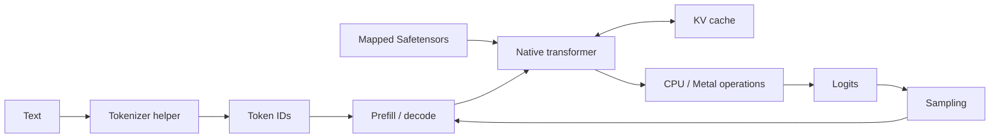

# Kestrel

Native Llama-family inference in C++20 with CPU and Metal execution: the transformer forward pass runs directly in Kestrel, without PyTorch, llama.cpp, MLX, ONNX Runtime, or another inference engine.

- Memory-mapped Safetensors loading with F32/F16/BF16 storage, shape validation, and shard support.
- RMSNorm, split-half RoPE, grouped-query causal attention, SwiGLU, and contiguous KV caching.
- Greedy or temperature/top-k/top-p sampling; token-ID and text CLI entry points.
- Independent reference comparisons, reproducible benchmarks, and operation profiling.
- Text tokenization uses a separate SentencePiece/Tokenizers helper; inference and sampling are native.



## Correctness

The same pinned TinyStories checkpoint and six token IDs are compared against Hugging Face eager FP32 inference at embeddings, every layer, final hidden states, and logits. These results cover all six positions; tolerances apply to every stage.

<!-- BEGIN NUMERICAL RESULTS -->

| Backend | Max logit error | Mean logit error | Cosine similarity |
|---|---|---|---|
| [cpu](benchmarks/results/20260918T043128Z-validation-cpu.json) | 3.695488e-05 | 4.123539e-06 | 0.999999999999775 |
| [metal](benchmarks/results/20260918T043128Z-validation-metal.json) | 4.124641e-05 | 4.932517e-06 | 0.999999999999685 |

<!-- END NUMERICAL RESULTS -->

Fresh test results and sanitizer evidence are in [numerical correctness](docs/correctness.md). CUDA and ASan are not passing claims.

## Measured performance

Apple M2 Pro, batch 1, pinned 15.19M-parameter FP32 TinyStories model. Same Release executable, 16 repeated-BOS prompt tokens, 32 generated tokens, two warm-ups, five measured runs; profiling disabled. Loading and tokenization are excluded.

<!-- BEGIN BENCHMARK RESULTS -->

| Backend | Prefill tok/s | Decode tok/s | TTFT ms |
|---|---|---|---|
| [cpu](benchmarks/results/20260918T043128Z-benchmark-cpu.json) | 51.47 | 53.05 | 310.91 |
| [metal](benchmarks/results/20260918T043128Z-benchmark-metal.json) | 38.49 | 38.61 | 415.80 |

<!-- END BENCHMARK RESULTS -->

The first generated token comes from prefill: each run has 31 decode intervals. These are local desktop measurements, not serving benchmarks. See [performance and profiling](docs/performance.md) for elapsed times, latency percentiles, raw samples, and measured facts versus optimization hypotheses.

## Example generation

From the repository root, after building:

```sh
./build-audit/kestrel --model models/tinystories-15m --backend cpu \
  --prompt "Once upon a time" --max-tokens 32 --temperature 0 \
  --tokenizer-python .venv/bin/python
```

Use `--backend metal` for GPU execution. `--tokens 1,9038,2501,263,931,29889` bypasses the tokenizer. `--interactive` starts a fresh context for each input line; `/quit` exits. This checkpoint is a small story-completion model.

## How it works

`Model::forward` performs one causal transformer step. `Session::prefill` processes prompt tokens sequentially; `Session::decode` reuses cached keys and values. The CPU backend executes scalar reference loops. Metal uses original GPU kernels through a synchronous host-FP32 interface, with prepared projection weights and per-operation buffers. [Architecture and inference walkthrough](docs/architecture.md) explains the actual shapes and data flow.

## Building

Requires macOS for Metal, C++20, CMake ≥3.25, Ninja, and Python for tests/tokenization. The tested environment already has `.venv`; on a fresh checkout create it and install the pinned files in `tools/requirements-build.txt` and `tools/requirements-validation.txt`.

```sh
export PATH="$PWD/.venv/bin:$PATH"
cmake -S . -B build-audit -G Ninja -DCMAKE_BUILD_TYPE=Release \
  -DKESTREL_METAL=ON -DKESTREL_REFERENCE_TESTS=ON \
  -DPython3_EXECUTABLE="$PWD/.venv/bin/python"
cmake --build build-audit -j 4
python tools/download_model.py
```

The download command verifies local files against pinned SHA256 hashes and downloads missing files. On Linux or for a CPU-only build, use `-DKESTREL_METAL=OFF` in a separate build directory. CUDA source is present but unverified on NVIDIA hardware.

## Validation and testing

```sh
ctest --test-dir build-audit --output-on-failure --timeout 60
python tools/run_evidence.py --build build-audit
python tools/report_results.py
```

The evidence runner verifies checkpoint hashes, compares pretrained CPU/Metal outputs, exercises text/interactive generation, then runs benchmarks sequentially. It requires Metal device access. The report script audits result arithmetic and regenerates documentation tables. [Correctness](docs/correctness.md) includes CPU-only, UBSan, ASan, and individual reference commands.

## Repository structure

| Path | Purpose |
|---|---|
| `include/kestrel/`, `src/` | Tensors, loader, model, cache, sampling, CLI |
| `src/backends/` | CPU loops, Metal kernels, unverified CUDA source |
| `benchmarks/` | Native harness and timestamped execution results |
| `tests/` | Native, malformed-input, CLI, tokenizer tests |
| `tools/` | Checkpoint lock, reference comparisons, evidence/report scripts |
| `docs/` | Architecture, correctness, profiling, implementation record |

## Current limitations

- CUDA compilation and execution remain unvalidated on NVIDIA hardware.
- Metal batch-1 decode is slower than CPU in the recorded workload; kernels, allocation, and synchronization remain optimization targets.
- Prefill is sequential and runs the LM head for every prompt token. No fused prompt GEMMs or FlashAttention.
- KV storage is contiguous host memory, without paged allocation or continuous batching.
- Selected bias-free Llama configurations only; scaled RoPE, quantization, and alternate architectures are rejected.
- F16/BF16 are storage formats; activations and GPU projection buffers use FP32.
- ASan compilation succeeds, but execution stalls during local runtime initialization; ASan is unverified.
- No multi-user serving, concurrency guarantees, or production-scale performance claims. Instances are not thread-safe.

## Technical documentation

- [Architecture and inference walkthrough](docs/architecture.md)
- [Numerical correctness](docs/correctness.md)
- [Performance and profiling](docs/performance.md)
- [Implementation record](docs/implementation.md)
- [Safetensors loading](docs/safetensors.md), [KV cache](docs/kv-cache.md), [backend contract](docs/backends.md)
- [Upgrade audit and exact commands](docs/upgrade-audit.md)
