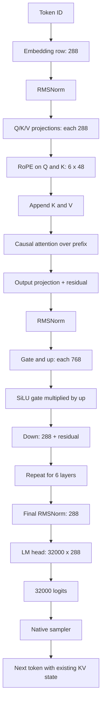

# Architecture and inference walkthrough

Kestrel implements the bias-free, SiLU, full-head rotary Llama architecture. The initial pretrained checkpoint is `sdobson/tinystories-llama-15m` at revision `6cc2bab8c4a55cce6f7532317af84a94bb340d5e`: hidden width 288, intermediate width 768, six layers, six attention and KV heads, head dimension 48, vocabulary 32,000, context limit 256. This is a small story-completion model, not a general assistant. The separate deterministic fixture exercises grouped-query attention (four Q heads, two KV heads).

## Entry points and storage

Text enters `src/main.cpp`, which starts the tokenizer helper through `src/tokenizer.cpp`. The helper handles SentencePiece or Tokenizers JSON assets and returns token IDs. `--tokens` bypasses that process entirely. Checkpoint parsing, all forward passes, KV state, and sampling stay in C++.

`Weights` owns read-only POSIX mappings parsed by the native Safetensors loader. Views carry dtype, shape, contiguous row-major strides, and byte extent; weights use `[out, in]` matrix layout. The downloaded checkpoint stores 15,191,712 unique F32 elements, with one tied embedding/LM-head matrix. Headers and actual payloads, rather than the model's marketing name, determine this count. See [loader validation](safetensors.md).

## One token through the network

`Model::forward` in `src/model.cpp` is the entire native transformer path. The checkpoint embedding row becomes a float vector `x[hidden]`. Each layer does:

1. RMSNorm: `n = x * rsqrt(mean(x²) + epsilon) * weight`.
2. Q, K, V projections with checkpoint matrices shaped `[out, in]`.
3. Interpret Q as `[heads, head_dim]` and K/V as `[kv_heads, head_dim]`.
4. Apply RoPE to Q and K at the absolute cache position.
5. Append K/V; attend only to the available prefix.
6. Output projection and residual addition.
7. Second RMSNorm, gate/up projections, `SiLU(gate) * up`, down projection, residual addition.

After all layers, final RMSNorm and the LM head produce one logit per vocabulary entry. Tied embeddings may be stored under either `model.embed_tokens.weight` or `lm_head.weight` when `tie_word_embeddings=true`. Embedding lookup and sampling run on the CPU even with a GPU backend.

All activation arithmetic is FP32. F16/BF16 checkpoint values are decoded to float; CPU reads original weight storage, GPU backends keep additional FP32 projection buffers. This is not half-precision compute or quantized inference. Values are accumulated in float; order and transcendental implementations differ between backends.

## Prefill versus decode

`Session::prefill` validates a nonempty prompt, resets its cache, and processes prompt tokens in sequence. Only the last logits are returned. This reference implementation computes a complete forward pass, including the LM head, for each prompt token. It does not implement batched prompt GEMMs or FlashAttention.

`Session::decode` accepts one new token, uses the existing cache length as position, and appends exactly one entry per layer. It never recomputes earlier keys or values. A failed forward resets the session rather than retaining a partially appended cache.

The first generated token is sampled from the last prefill logits. Producing N generated tokens takes N−1 decode forwards. The last sampled token is not inserted into the cache until another decode is requested. Maximum context is checked before CLI generation. Each interactive input starts a new context; conversation templates and conversation history are not automatically applied.

## Grouped-query attention and causality

For query head `h`, K/V head `floor(h / (heads / kv_heads))` is shared by a contiguous group of query heads. Shapes must satisfy `hidden % heads == 0` and `heads % kv_heads == 0`. Scores are `Q·K / sqrt(head_dim)`; a max-subtracted softmax normalizes over positions. The weighted sum of V is concatenated across query heads before output projection.

Causality comes from the cache prefix: position t can read only positions 0…t. There are no future entries in the spans passed to attention. Sequential prefill and cached decode share this invariant. Reference validation compares this execution to Hugging Face's independently batched, causally masked forward pass.

## Rotary positional embeddings

For half-index i and position p, angle = `p * theta^(-2*i/head_dim)`. Kestrel uses Hugging Face Llama's split-half layout: pair coordinate i with i + head_dim/2, then apply a two-dimensional rotation. It does not use adjacent interleaved pairs. Q and K rotate; V does not. Head dimension must be even. Scaled RoPE, partial rotary, and alternate RoPE configurations are explicitly rejected.

## Sampling

Temperature zero selects the first maximum deterministically. Positive temperature subtracts the maximum before exponentiation. Top-k keeps the highest k logits (zero means all), then top-p retains the shortest sorted probability prefix meeting p, including the threshold-crossing token. The retained probabilities are renormalized for sampling. A per-instance Mersenne Twister uses the supplied seed; no global RNG exists. Nonfinite logits and invalid sampler settings fail explicitly.

## Why cache K/V, and how GQA changes storage

A new query needs every earlier key for attention scores and every earlier value for the weighted sum. Earlier queries are never used by a later position, so retaining Q would consume memory without removing work. Cached K is already rotated at its original position; V is unrotated. The query of the new token attends to the inclusive prefix, preserving causality without materializing a future-position mask.

The cache owns two FP32 arrays in `[layer, capacity, kv_head, head_dim]` order. It costs `2 * layers * capacity * kv_heads * head_dim * 4` bytes. The benchmark capacity is 16 + 32 − 1 = 47, giving 649,728 bytes for this checkpoint. Its six KV heads equal its six query heads, so this particular checkpoint receives no GQA storage reduction. The fixture's four query/two KV heads exercise sharing and halve KV storage relative to four KV heads. Reset clears committed lengths, not allocations; append rejects out-of-order positions. Failed forwards reset the session to avoid partially committed layer state.

## Backend boundary and actual execution

`Backend` takes host FP32 spans and contiguous weight views. Every method returns with its output ready. Transformer ordering is shared across implementations; there is no graph executor or silent backend fallback.

The single-threaded CPU implementation performs direct loops over weight rows, with dtype decoding and float accumulation. It has no explicit BLAS or SIMD implementation. Compiler auto-vectorization is not measured here.

Metal prepares FP32 projection weights at model load. Each operation allocates shared buffers, copies host inputs, encodes commands, commits, waits for completion, and copies outputs into host vectors. Attention runs score, softmax, and value kernels separately; K/V prefixes are copied from the host cache each time. Unified memory does not eliminate these explicit allocations and copies. Embedding lookup, cache insertion, and sampling run on CPU. Safe-math Metal kernels are compiled at runtime, before benchmark timing.

The profiler measures completed operation wall time. Separate nested diagnostics measure existing command encoding/submission and host waiting; they are not GPU kernel timestamps. See [performance](performance.md) for measured costs and limits of interpretation. CUDA implements the same synchronous contract in source, but remains unverified on NVIDIA hardware.
